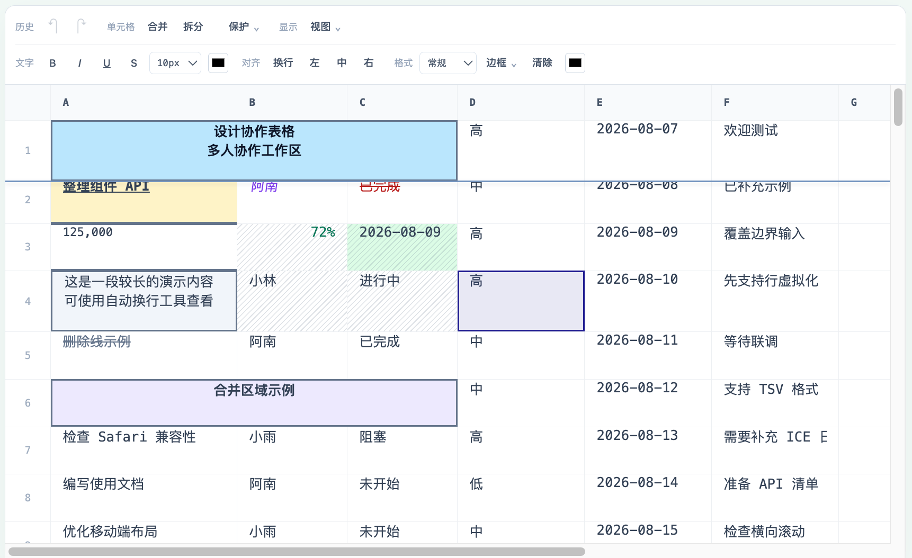

# Colwork

基于 Yjs 的多人协作表格前端库，使用原生 DOM 渲染，提供 Vue / React 演示页。

示例地址



## 安装与使用

```sh
npm install @kuzuma/colwork
```

```ts
import { ColworkTable } from '@kuzuma/colwork'
import '@kuzuma/colwork/colwork.css'

const table = new ColworkTable(document.querySelector<HTMLElement>('#table')!, {
  room: 'my-room',
  user: '协作者',
  transport: 'websocket',
  websocketUrl: 'wss://your-domain/rooms',
  rowCount: 100,
  columnCount: 10,
})

// Vue / React 组件卸载时清理实例。
// table.destroy()
```

在浏览器中创建实例，并准备好表格容器和自己的 Yjs WebSocket 服务；npm 包不包含服务端。包提供 ES / UMD 构建及 TypeScript 类型声明，Vue / React 示例见下方开发入口。通过浏览器直接使用 UMD 构建时，需要先提供 `Y`、`YAwareness`、`YWebrtc` 和 `YWebsocket` 全局依赖。

### 从 0.3 升级到 0.4

- 将使用 `@kuzuma/colwork` 的前端、协作服务和锁文件一起更新。尤其是通过 `@kuzuma/colwork/model` 校验或保存 Yjs 快照的服务，升级后才能识别新版的校验规则、条件格式和分析配置。宿主若另外维护根白名单，请加入 `colwork-validation`、`colwork-conditional-format`、`colwork-analyses` 及各工作表下的同名根。若用规范化内容计算保存摘要，同时纳入 `getSheetFeatureMaps()` 提供的规则和分析配置。
- 现有 `ColworkTable`、`ColworkWorkbook` 及宿主管理连接的构造参数继续可用。复测外层布局对新增公式栏的适配，以及 Enter 提交后下移、Tab 横向移动的行为。
- 要启用版本历史，按下方示例注册 `versionHistory`。保存的版本由宿主管理，注册后默认关闭浏览器会话更新日志。通过 `recordUpdateLog: true` 可以保留原有日志导出流程。
- 通过 `personalViewKey` 还原个人筛选时，请使用当前账号和文档的稳定标识。Excel 图片往返需要接入 `uploadImage` 和 `readImage`。
- 使用 Colwork 自带 Cloudflare Worker 的项目可启用双向大消息分帧。部署时先更新 Worker，再让客户端开启 `websocketChunks` 或 `createColworkWebSocket()`。自管或第三方 WebSocket 服务可继续沿用原来的传输配置。Worker 现在会同时使用快照和增量日志，回滚旧版 Worker 前应先导出并妥善保管完整的当前快照。

### 从 0.2 升级到 0.3

0.3 支持旧存档，并使用稳定的行列标识同步增删操作。在共享房间启用增删行列前，请将协作客户端统一升级到 0.3。使用仓库自带 Cloudflare 后端时，请同步升级服务端。默认行高改为 28 px，已有的自定义行高继续从存档读取。

## 宿主管理协作连接

0.2.0 的 `external` 模式接受宿主创建的 Y.Doc 与 Awareness，适用于自选 Provider 的应用。Provider 的连接、重连、认证、保存和最终销毁由宿主负责。

```ts
import * as Y from 'yjs'
import { Awareness } from 'y-protocols/awareness'
import { ColworkTable } from '@kuzuma/colwork'
import { initializeBlankSheet } from '@kuzuma/colwork/model'
import '@kuzuma/colwork/colwork.css'

const document = new Y.Doc()
const awareness = new Awareness(document)
initializeBlankSheet(document) // 仅在创建新的空白表格时调用。
// 在宿主中将自己的 Provider 连接到同一个 document 和 awareness。

const table = new ColworkTable(container, {
  transport: 'external',
  collaboration: { document, awareness },
  user: '协作者',
  rowCount: 100,
  columnCount: 10,
  readOnly: false,
  onEditingChange({ editing, dirty }) {
    // dirty 表示当前单元格有尚未提交到 Yjs 的输入。
    updateDraftIndicator({ editing, dirty })
  },
})

table.commitEditing() // 宿主保存、发布或导出前可明确提交输入。
const snapshot = table.getYjsSnapshot()
table.cancelEditing() // 丢弃输入，继续显示共享文档的当前值。
table.setReadOnly(true)
table.destroy()
// 所有使用者卸载后，由宿主清理 Provider、awareness 和 document。
```

`external` 模式的 `room` 可省略，仅作为可选存档标识。`Awareness` 必须属于传入的同一个 `Y.Doc`。此模式从传入文档读取内容，保留空表，不建立网络连接，也不插入示例内容。`rows`、`snapshot`、`updates` 和 `initializeAfterSync: true` 会被拒绝，文档初始化或载入应由宿主在创建表格前完成。内建 WebSocket、WebRTC 和离线快照模式继续支持原有选项与示例初始化。

`readOnly: true` 与 `setReadOnly(true)` 禁止本机修改，继续订阅文档更新并显示协作者选区。切为只读会取消当前输入、尺寸拖动和待处理的密码操作。实际权限由宿主及服务端实施。

`getYjsSnapshot()` 和 `getYjsUpdateLog()` 保持纯读取。`onEditingChange` 在开始输入、输入变化和结束编辑时同步通知。显式提交先更新 Yjs，再通知 `{ editing: false, dirty: false }`。外部模式 `destroy()` 丢弃尚未提交的输入，清理本组件的监听和撤销历史，保留宿主文档与 Awareness。重复销毁安全。原内建模式卸载时继续提交输入并销毁自有连接与文档。

### Awareness 字段约定

表格读取 `user.name`、`user.color`、`selection` 和 `cursor`，发布本机 `selection`、`cursor` 与 `editing`。已有 `user` 字段会保留，仅在缺少字段时补入 `user` 选项中的显示身份。宿主已将本机状态设为 `null` 时，组件保留该状态。

```ts
type Presence = {
  user?: { name?: string; color?: string }
  selection?: {
    anchor?: { row: number; column: number }
    focus?: { row: number; column: number }
    mode?: 'row' | 'column' | 'all'
  }
  cursor?: { row: number; column: number; offset?: number }
  editing?: string | null // 编辑中的 row:column，或 null。
}
```

多个组件可共享同一个 Awareness，最后交互的组件负责当前本机选区。销毁时仅清除仍属于本实例的选区、光标与编辑字段，保留宿主后续写入的字段和其他本机状态。

## 工作簿、个人视图和 Excel

打开本地的 `/test/workbook.html` 可以试用工作表标签、个人排序筛选、公式和 Excel 文件。加上相同的 `?room=team` 可在多个浏览器窗口使用同一协作工作簿。受保护文档同样使用工作簿组件。

```ts
import { ColworkWorkbook } from '@kuzuma/colwork'
import '@kuzuma/colwork/colwork.css'
import { importXlsx, exportXlsx } from '@kuzuma/colwork/xlsx'

const workbook = new ColworkWorkbook(container, {
  collaboration: { document, awareness },
  user: viewer.displayName,
})
const [importedSheet] = await importXlsx(document, await file.arrayBuffer())
workbook.setActiveSheet(importedSheet)
const bytes = await exportXlsx(document)
// 在受保护的场景，先从服务端取得经过授权的快照，再转换成 XLSX。
```

- **工作表**可以新增、改名、删除、切换及拖动重排。键盘可用 Alt + 左右方向键重排标签。工作表及其内容会同步，当前标签和个人视图留在本机。已有单表存档会打开为第一张工作表。宿主可用 `listWorkbookSheets()` 获取工作表，再将表 ID 传给 `getSheetMaps()` 或 `readSheetSnapshot()`。
- **个人排序筛选**可选择排序列和方向、保留标题行，并同时按多列的文字包含条件筛选。它只调整当前视图，编辑仍会写回对应记录。宿主可调用 `ColworkTable.setRowView()` 或 `openRowView()`。跨行合并涉及的相邻行会作为一组移动。保留标题行的边界如果穿过一个合并组，会保留整组。筛选时组内至少一行满足全部条件就会保留整组。增删行列前需清除当前视图。设置 `personalViewKey` 可在刷新后恢复筛选条件，请用宿主账号与文档 ID 组合出稳定的键。
- **公式**可输入 `=A1*2`、`=SUM(B2:B8)`、`=IF(A1>0,"有值","空")` 或 `='预算表'!B2`。支持算术、比较、百分比、连接、范围、跨表引用，以及常用统计和逻辑函数，包括 `SUMIF`、`SUMIFS`、`COUNTIF`、`COUNTIFS` 和单值 `XLOOKUP`。新增公式将引用绑定到工作表和行列标识，改名、插行后引用仍指向原记录。被删除的引用显示 `#REF!`，循环引用显示 `#CYCLE!`。用 `'=` 开头可录入以等号开头的文本。
- **Excel**支持 `.xlsx` 工作表、常见值、公式、合并、行列尺寸和 Colwork 支持的单元格格式。导入将工作表加到当前工作簿，独立的新建文档可传入 `{ replaceBlankMain: true }` 复用空白首页。导出使用共享顺序和全量可见工作表数据。导入上限为 10 MB、32 张工作表、十万单元格。支持往返常见的内嵌图片、内联下拉列表和单色条件格式。其他 Excel 函数可随公式往返保留。Excel 的宏、原生图表、原生数据透视表及高级规则暂未实现转换。
- 宿主可为 `importXlsx()` 注册 `confirmWarnings(warnings)`。库检测到会省略的原生图表、透视表或部分高级规则时，会在上传图片和写入工作簿前调用。回调可异步展示清单，返回 `true` 继续，返回 `false` 取消。每条提示包含功能类型，图表及透视表提示带数量，能定位的规则提示带工作表名。已有调用方可继续使用原接口。
- `exportXlsx()` 也接受 `confirmWarnings(warnings)`。导出检查会按工作表报告无法保留的图表、透视配置、单元格保护、部分下拉规则和将用说明替代的图片。库在读取图片资源后、生成文件之前调用回调，宿主可异步确认。若回调返回 `false`，导出会取消。配置确认回调时，读取图片失败也会作为一项差异交由宿主决定。

## 编辑及分析

- 方向键移动，Shift + 方向键扩选，Tab 横向移动，Enter 提交并下移。F2、空格与直接输入可进入编辑。选中单元格后可从公式栏查看和修改原始内容。
- 编辑期间收到同一单元格的新内容时，提交草稿前会询问是否覆盖。切换工作表会保留各表的本地撤销与重做记录。
- 支持富剪贴板的浏览器中，右键菜单和快捷键在 Colwork 内复制时都保留格式，公式的相对引用随粘贴位置移动。浏览器限制富复制时，右键菜单回退到纯文本。粘贴能扩展工作表的可视范围，支持外部表格中的带引号多行单元格。目标包含锁定单元格、违反数据验证或超出筛选视图时，会提示并拒绝整批写入。
- 右键选中目标单元格后打开「选择性粘贴」，选择方式并按 Ctrl/⌘ + V。「仅粘贴值」保留目标格式，来自新版 Colwork 的公式会粘贴为复制时的计算结果，外部纯文本按文字写入。「仅粘贴格式」使用 Colwork 剪贴板数据，保留目标内容和公式。
- 从选区右下角拖动填充柄可复制格式和内容、延续等差数列，并移动公式的相对引用；公式中的绝对引用保持原位。填充范围需要为普通、可编辑的单元格。
- Ctrl/⌘ + F 或工具栏「查找」可定位当前工作表视图中的内容。替换支持当前项和全部文本。
- 「数据」菜单可配置下拉校验、包含／等于／大于／小于／空白高亮，以及以选区首行为标题的柱状图、折线图、行列分组透视汇总。分析设置随工作表同步，汇总可选择求和、计数和平均值。宿主可通过 `getSheetFeatureMaps(document, sheetId)` 获取规则和分析的 Yjs 根。

## 版本历史接入

在 `ColworkTable` 或 `ColworkWorkbook` 上注册 `versionHistory` 后，界面显示「版本历史」。具体数据读写由宿主提供的回调完成。

```ts
const versionHistory: ColworkVersionHistory = {
  documentId,
  list: ({ documentId, cursor, signal }) =>
    historyService.list(documentId, { cursor, signal }),
  read: ({ documentId, versionId, signal }) =>
    historyService.readSnapshot(documentId, versionId, { signal }), // Promise<WorkbookSnapshot>
  create: ({ documentId, label, signal }) =>
    historyService.saveCurrent(documentId, { label, signal }),
  restore: ({ documentId, versionId, signal }) =>
    historyService.restore(documentId, versionId, { signal }),
}

const workbook = new ColworkWorkbook(container, {
  collaboration: { document, awareness },
  user: viewer.displayName,
  versionHistory,
  recordUpdateLog: false,
})
```

- `list` 只返回当前页的版本元数据和可选的 `nextCursor`，并可单独注册为只读历史。宿主负责鉴权、版本留存和提交的原子性。关闭面板会中止前端等待，请用 `signal` 取消可取消的网络请求。
- 可选的 `read` 按需返回已授权的 `WorkbookSnapshot`。注册后可预览历史版本与当前工作簿或另一个已列出的版本之间的差异，涵盖工作表、单元格和规则。只读用户也可预览宿主授权的版本。宿主如果存储完整的 Yjs 更新，可用 `readWorkbookSnapshotUpdate(bytes)` 转换。
- 保存前 Colwork 会提交当前编辑。建议宿主等待协作更新落库，再从服务端捕获版本。若宿主需要保存客户端快照，可设 `captureClientSnapshot: true`，此时允许导出的实例会向 `create` 提供一个 `snapshot`。宿主可自行决定快照或增量的存储策略。
- `restoreWorkbookVersion(liveDoc, versionBytes)` 在给定 Yjs 文档中恢复 Colwork 数据，保留宿主自定义的 Yjs 根。宿主在提交恢复时负责检查当前版本和写权限，并决定是否先归档当前内容。需要让恢复成为新的编辑起点时，宿主需让客户端切换到新的协作会话，按业务规则拒绝或另存旧会话积压的更新。继续在原会话中同步时，迟到的旧更新仍会按 Yjs 规则合并。宿主也可在副本上准备并校验恢复结果，再提交服务端状态。
- 默认注册版本历史后会关闭旧的浏览器会话更新日志，仍可通过 `recordUpdateLog: true` 显式开启。库沿用构造参数注册回调及已有的 `onEditingChange`，React 和 Vue 共用同一个接口。独立的工作簿演示以浏览器 IndexedDB 实现宿主存储，保留最近 12 个版本。

## 单元格图片

在创建 `ColworkTable` 或 `ColworkWorkbook` 时传入 `images`。`upload` 负责调用宿主上传接口并返回稳定资源 ID，`resolveUrl` 把 ID 转成当前用户可读取的地址。工作簿只同步图片 ID 和可选说明。只读组件可以仅提供 `resolveUrl`。

```ts
const images = {
  async upload(file: File) {
    const form = new FormData()
    form.append('file', file)
    const response = await fetch('/api/assets', { method: 'POST', body: form })
    if (!response.ok) throw new Error('图片上传失败')
    return await response.json() as { id: string; alt?: string }
  },
  resolveUrl(id: string) {
    return '/api/assets/' + encodeURIComponent(id)
  },
}
const table = new ColworkTable(container, { ...options, images })
```

选中单元格后可通过「插入图片」选择文件，也可直接粘贴 PNG、JPEG、GIF 或 WebP。宿主应在上传和取图接口校验权限。私有图片可以使用同源鉴权地址或由宿主生成的短期签名地址。Yjs 快照保留图片引用，恢复快照时仍需访问原图片资源。Excel 侧通过 `importXlsx(document, bytes, { uploadImage })` 将 PNG、JPEG、GIF 图片交给宿主存储，并按左上锚点映射到单元格。导出可注册 `exportXlsx(document, { readImage })` 取回字节并嵌入，缺少可读取的图片时导出说明。

本地 Cloudflare 演示提供临时上传接口，每张图片最多 512 KB。业务部署应接入宿主自己的存储和权限。

## 水印与导出策略

宿主可以在构造时传入 `viewPolicy`，权限或身份变化时用 `setViewPolicy()` 替换整份策略。下面的 `permissions` 和 `viewer` 由宿主应用提供。

```ts
import { ColworkTable, type ColworkViewPolicy } from '@kuzuma/colwork'

const viewPolicy: ColworkViewPolicy = {
  watermark: {
    viewerText: permissions.addViewerWatermark ? viewer.displayName : undefined,
    fixedText: permissions.addFixedWatermark ? permissions.fixedWatermarkText : undefined,
  },
  allowExport: permissions.allowExport === true,
  versionPreview: permissions.allowExport === true ? 'full' : 'summary',
}
const table = new ColworkTable(container, { ...options, viewPolicy })

// 根据 canExport() 显示或禁用宿主的导出按钮。
if (table.canExport()) {
  table.commitEditing()
  const snapshot = table.getYjsSnapshot()
  // 由宿主保存或下载 snapshot。
}
// 宿主收到新策略后调用 table.setViewPolicy(nextViewPolicy)。
```

- `viewerText` 与 `fixedText` 独立生效，可以同时显示。空白文本关闭对应水印，长文本以省略号截断。水印覆盖表格视口和打开的版本历史窗口，删除水印节点或改写其属性后会自动恢复。每个实例独立应用策略，水印文字留在本机，不进入协作数据或存档。
- `allowExport` 默认开启，兼容旧接入。关闭后，`canExport()` 返回 `false`，`getYjsSnapshot()` 和 `getYjsUpdateLog()` 抛出 `NotAllowedError`。宿主管理的后台保存可继续使用宿主持有的文档及模型 API。
- `versionPreview` 默认是 `'full'`。设为 `'summary'` 时，版本对比展示变更数量、可用的单元格位置及规则类型，省略单元格内容。切换为摘要会立即移除已经呈现的内容，恢复完整模式后可重新预览。宿主可独立配置此选项及 `allowExport`，并负责鉴权及返回当前用户可读取的快照。
- 宿主应从可信业务策略和当前登录身份生成配置，并在自己的文件下载或导出接口校验权限。浏览器内的水印与导出限制提供客户端防护，表格数据仍需交给浏览器渲染。

从本地源码运行的 Vue 和 React 演示可用 `?viewerWatermark=1&fixedWatermark=1&allowExport=0` 查看两种水印和禁用导出的效果。查询参数只用于演示。

### 受保护文档

Cloudflare 部署提供独立的受保护文档入口 `/test/document.html?id=DOCUMENT_ID`。宿主在用户登录后，按账号和文档权限签发短期 `colwork_session` Cookie。受保护房间与公开演示房间分别存储。文档标识支持 1 到 128 个 ASCII 字母、数字、下划线和连字符。

在 Worker 的后端配置至少 32 字节的随机密钥 `COLWORK_SESSION_SECRET`，宿主签发端使用同一份密钥。以下是 Node 签发示例。账号、文档和权限字段均由宿主服务端生成。

```js
import { createHmac } from 'node:crypto'

const claims = {
  aud: 'colwork',
  sub: user.id,
  name: user.displayName,
  exp: Math.floor(Date.now() / 1000) + 300,
  documents: [{ id: document.id, canEdit: true, allowExport: false, viewerWatermark: true, fixedWatermark: '内部资料' }],
}
const payload = 'v1.' + Buffer.from(JSON.stringify(claims)).toString('base64url')
const token = payload + '.' + createHmac('sha256', process.env.COLWORK_SESSION_SECRET).update(payload).digest('base64url')
const cookie = `colwork_session=${token}; Path=/; HttpOnly; Secure; SameSite=Strict; Max-Age=300`
// 由宿主在承载 Colwork 的同一来源返回 Set-Cookie。
```

- `GET /api/documents/:id/view-policy` 返回经验证的登录名称、编辑权限及当前文档的水印策略。会话最长接受 15 分钟有效期，令牌最多 3800 字符。权限变更后由宿主签发新会话。
- `GET /api/documents/:id/export` 在每次请求时校验会话和导出权限，下载服务端已经同步的 Yjs 快照。只读权限和导出权限分别判断。
- `/rooms/private/:id` 验证同源 WebSocket 和相同的登录会话，只读连接无法写入文档。支持查看文档的浏览器会收到渲染所需的同步数据。

## 文档模型与 Node 入口

`@kuzuma/colwork/model` 提供 ES / CommonJS 与独立类型声明，可在 Node 中导入，运行时仅依赖 Yjs。此入口用于校验、数据读取、空表初始化和存档导出。

```ts
import {
  COLWORK_SCHEMA_VERSION,
  COLWORK_MAP_NAMES,
  getSheetMaps,
  initializeBlankSheet,
  validateSheetDocument,
  readSheetSnapshot,
  readSheetSnapshotUpdate,
  exportYjsSnapshot,
} from '@kuzuma/colwork/model'

const issues = validateSheetDocument(document, {
  maxRows: 10000,
  maxColumns: 1000,
  maxEntries: 50000,
  maxStringLength: 8192,
  maxMergeArea: 10000,
  maxMerges: 1000,
}) // 以上为宿主自行选择的示例策略。
if (issues.length) throw new Error(issues[0].message)
const sheet = readSheetSnapshot(document)
const archive = exportYjsSnapshot(document, { room: 'optional-label', sequence: 0 })
```

公开快照格式版本为 `COLWORK_SCHEMA_VERSION = 1`，兼容 0.1.0 的存档。`COLWORK_MAP_NAMES` 提供下列 `Y.Map` 根名。

| 根名 | Key | Value |
| --- | --- | --- |
| `cells` | `row:column` | 原始文本字符串 |
| `styles` | `row:column` | JSON 编码的 `CellStyle` |
| `rowHeights` | 行索引字符串 | 有限正数，逻辑像素 |
| `columnWidths` | 列索引字符串 | 有限正数，逻辑像素 |
| `merges` | `startRow:startColumn-endRow:endColumn` | 字符串 `"1"`，闭区间 |
| `locks` | `row:column` | `"1"`，或 JSON 编码的 `PasswordLock` |
| `colwork-metadata` | `initialized`、`schemaVersion` | 可选 boolean 与版本整数 |

坐标从零开始，使用规范十进制非负安全整数。`CellStyle` 支持 `bold`、`italic`、`underline`、`strike`、`wrap` 布尔字段，`fontSize` 正数，`color`、`background` 字符串，`align` 为 `left / center / right`，`format` 为 `general / number / date / percent`，以及 `border.top / right / bottom / left` 布尔字段。`PasswordLock` 为版本 1 的 PBKDF2-SHA-256 记录，包含 `iterations: 600000`、32 位小写十六进制 `salt` 和 64 位小写十六进制 `verifier`。

`validateSheetDocument()` 返回 `{ path, message }[]`。校验覆盖根类型、隐藏序列、嵌套值、样式与密码记录结构、坐标、尺寸和重叠合并，并要求文档已解析全部因果依赖。未知根默认拒绝，宿主需要扩展根时可传 `allowUnknownRoots: true`。未知样式与元数据字段、孤立 UTF-16 代理码位仍会拒绝。可选限制默认不设置应用特定数值上限，`maxEntries` 统计全部已知根的可见条目，包括元数据，`maxStringLength` 统计存储字符串的 UTF-16 长度。`maxMergeArea` 限定单块合并的逻辑单元格数，`maxMerges` 限定合并块数。二进制请求大小和实际授权由宿主控制。

`readSheetSnapshot()` 校验后返回稀疏、可 JSON 序列化的 `SheetSnapshot`。字段依次为 `schemaVersion`、`rowCount`、`columnCount`、`cells`、`styles`、`rowHeights`、`columnWidths`、`merges` 和 `locks`。记录按数字坐标排序，样式、边框与密码记录使用固定字段顺序，合并按起点和终点排序。返回值不包含存档标识、更新序号或在线状态，适合宿主计算内容摘要。尺寸从持久条目推导，最小为 1，空白视图容量与固定窗格属于本地状态。渲染时合并块裁剪为可见片段，值、样式和编辑仍映射到原始左上角单元格，巨型合并不会扩张整块 DOM。显示尺寸沿用交互界面的最小行高与列宽，较小的持久尺寸会在本地显示时夹取，原始文档数值保留。

`readSheetSnapshotUpdate(bytes, limits?)` 从完整 Yjs 状态更新读取相同结构，内部释放临时文档。尚有未解析插入或删除依赖的增量会被拒绝。`initializeBlankSheet()` 只接受空白表格，设置 `schemaVersion` 和 `initialized` 标记，可重复调用。`exportYjsSnapshot()` 返回原有 `colwork.snapshot` 格式，包含 Base64 状态与状态向量。导出保留 Yjs 原始状态，宿主可在调用前按自己的限制校验。

增删行列使用可选的 `colwork-row-edits`、`colwork-column-edits` 协作序列。原有单元格保留稳定标识，插入行列使用新标识，删除记录让相应标识从视图中消失。并发写入已删除行列的值不会显示，撤销删除可恢复该行列。原始 Yjs 快照可能包含已删除行列的并发写入，`readSheetSnapshot()` 只返回可见数据。旧快照直接载入，发生增删行列后，协作各方应使用支持该序列的版本。宿主直接写入 `getSheetMaps().cells` 前可用 `getSheetCellStorageKey(doc, '0:0')` 将显示坐标转换为存储键。

### 工作簿校验、快照和对比

服务端可通过 `@kuzuma/colwork/model` 使用整本工作簿的公共接口。

```ts
import { compareWorkbookSnapshots, readWorkbookSnapshot, readWorkbookSnapshotUpdate, validateWorkbook } from '@kuzuma/colwork/model'

const limits = { maxSheets: 32, maxEntries: 100000, maxMerges: 1000 }
const issues = validateWorkbook(document, limits)
const current = readWorkbookSnapshot(document, limits)
const previous = readWorkbookSnapshotUpdate(versionBytes, limits)
const changes = compareWorkbookSnapshots(previous, current, { maxExamples: 100 })
```

- `validateWorkbook()` 校验工作簿元数据、已登记工作表及已删除工作表的保留数据。`maxSheets` 限制可见工作表数，`maxRegisteredSheets` 限制登记总数（包括已删除的工作表），`maxEntries` 限制整本工作簿的总条目数。宿主可将同一个 `maxSheets` 传给 `ColworkWorkbook`、`addWorkbookSheet` 和 `importXlsx`，提前在操作处提示，并在服务端写入前统一校验。XLSX 转换器上限为 32 张可见工作表。设置 `allowUnknownRoots: true` 可保留宿主自定义根。
- `readWorkbookSnapshot()` 按共享顺序返回可见工作表。每张表包含原有 `SheetSnapshot`、数据验证、条件格式与分析定义。规则及分析相关坐标投影到共享行列。宿主可用返回值计算内容摘要，并用完整 Yjs 更新保存可协作的版本。
- `compareWorkbookSnapshots()` 统计全部差异，`maxExamples` 限制各表合计返回的单元格和规则示例。格式、保护、合并及尺寸的变化按类别报告。结构变化后按共享坐标比较单元格。
- 工作表重排把整份顺序写入 `colwork-workbook-layout` 的单个值。并发重排由 Yjs 选定一份顺序，并保留并发新增的工作表。读取接口也会处理旧版顺序中的重复 ID。
- 相交的并发合并按共享坐标选出可见区域，优先保留左上角靠前的区域。起点相同时依次比较结束行、结束列并优先保留较大的坐标。原始更新保留合并记录，单元格内容仍可在拆分后查看。整本工作簿的接口默认采用这套规则，`mergeConflicts: 'reject'` 可用于严格拒绝相交几何。既有单表接口默认保持严格校验，需要处理相交合并时可传 `mergeConflicts: 'resolve'`。

### 从 0.4 升级

1. 先升级协作后端。使用 `validateWorkbook()` 校验整本工作簿，将业务限额传入校验。维护自定义根白名单的项目需接受 `colwork-workbook-layout`。已保存内容摘要的项目应验证旧快照能继续通过原有摘要校验。
2. 再升级同一房间的客户端。已有快照可直接读取，仍使用 0.4 的客户端只会显示旧顺序。用旧文档测试打开、拖动标签、持久化和重新打开。
3. 需要版本预览时，为已有的 `versionHistory` 注册 `read` 回调，返回当前用户获准读取的 `WorkbookSnapshot`。版本存储、恢复操作和旧会话处理沿用宿主的接口。

### 从 0.5 升级

```sh
npm install --save-exact @kuzuma/colwork@0.6.0
```

1. 更新使用 Colwork 的前端、协作服务及锁文件。使用仓库自带的 Cloudflare 部署时，先更新 `colwork-backend`，再更新 `colwork-frontend`。现有工作簿和版本快照沿用原格式。
2. 如需显示保存状态，使用 `trackColworkWorkerSave(provider)` 连接配有 `createColworkWebSocket()` 的 Worker，或为自管协作服务使用 `ColworkSaveTracker`。订阅状态，在宿主选定的时机调用 `confirmSaved()`。调用前可用 `commitEditing()` 提交当前单元格输入。页面卸载时释放跟踪器。
3. 为 `importXlsx()` 和 `exportXlsx()` 按需传入 `confirmWarnings`，由宿主显示差异并决定继续或取消。下载接口继续按宿主的现有授权执行。版本预览可由宿主用 `viewPolicy.versionPreview: 'summary'` 仅展示摘要，窗口会显示宿主提供的水印。
4. 用已有工作簿验收双人编辑、保存回执、确认期间的新编辑、关闭后重开，以及带图表或保护的 XLSX 取消和继续流程。

## 开发

```sh
npm ci
npm run dev
```

- Vue：<http://127.0.0.1:5173/test/vue.html>
- 示例首页：<http://127.0.0.1:5173/>
- React：<http://127.0.0.1:5173/test/react.html>
- 快照与更新日志工具：<http://127.0.0.1:5173/test/index.html>

`npm run build` 执行 TypeScript 检查并构建 ES / UMD 库。

### 切换示例使用的库

Vue、React 和快照工具默认使用本地 `src/`，也可以测试 npm 发布版本，开关同时切换 JavaScript 和 CSS：

```sh
npm run dev -- --source=local
npm run dev -- --source=npm
```

npm 模式自动从官方 registry 安装 `@kuzuma/colwork@0.6.0` 到被 Git 忽略的 `.wrangler/npm-demo/`，不会修改项目依赖或锁文件；本地模式保留源码热更新。若要测试其他已发布版本，设置 `COLWORK_NPM_VERSION`：

```sh
COLWORK_NPM_VERSION=latest npm run dev -- --source=npm
npm run build:site -- --source=npm
```

根目录也提供 Makefile，先运行 `npm ci` 安装项目依赖：

```sh
make dev                           # 默认本地源码
make dev SOURCE=npm                # npm 发布版本
make dev SOURCE=npm NPM_VERSION=latest
make build-site SOURCE=npm         # 用 npm 版本构建网站
```

`COLWORK_SOURCE=local|npm` 也可设置默认来源，显式 `--source` 参数优先。切换来源后需要重启开发服务；Cloudflare 部署默认继续使用本地源码。

## Cloudflare 部署

使用两个独立 Worker，部署目标为：

| 服务 | Worker | 自定义域名 |
| --- | --- | --- |
| 前端 | `colwork-frontend` | `colwork.kuzuma.asia` |
| 后端 | `colwork-backend` | `api.colwork.kuzuma.asia` |

前端通过 Workers Static Assets 托管网站。`/api/*`、`/rooms/*` 和 `/health` 通过 `BACKEND` 服务绑定转发到后端，浏览器使用前端同源的 HTTPS/WSS，不需要配置跨域请求。后端自定义域名也提供 HTTP 接口和 WebSocket。

后端每个房间对应一个 SQLite Durable Object，处理 Yjs 同步、在线状态和文档持久化。每次更新保存完整 Yjs 状态，按 64 KiB 分块写入同一个 SQLite 事务；所有客户端离开或 Worker 重启后，内容、格式、合并、行列尺寸和锁定记录仍保留。在线状态只保存在连接附件中，断开后移除；固定范围继续是客户端本地状态。此版本适合现有演示规模，较大文档每次更新重写快照的开销需要后续优化。

### 首次部署

需要 Node.js 22 或更高版本，以及已将 `kuzuma.asia` 托管到 Cloudflare 的账号。SQLite Durable Objects 的套餐与用量以 [Cloudflare 官方说明](https://developers.cloudflare.com/durable-objects/platform/pricing/) 为准。

```sh
npm ci
npm run deploy
```

一条命令自动完成：检查 Git 忽略状态 → 缺少配置时从模板生成本地 `deploy.env` → 构建与类型检查 → 检查已有授权 → 必要时打开 Wrangler OAuth → 选择唯一账号 → 发布后端和前端、绑定域名 → 验证 HTTP、网站资产和 WSS 协作握手。首次 OAuth 仍需本人在浏览器中授权，后续部署复用授权。

本机已生成 `config/cloudflare/deploy.env` 时直接编辑，脚本保留现有内容并将文件权限设为仅当前用户读写。默认包含上述两个域名；如账号下有多个账户，在文件中设置 `CLOUDFLARE_ACCOUNT_ID`，脚本会在发布前停止，避免自动选错账号。可以运行 `npx wrangler whoami` 查看账号。

```sh
npm run deploy:check
npm run deploy
```

`deploy:check` 构建前端并检查两个 Worker 的打包结果，不请求登录、不发布、不创建线上存储，也不验证域名归属。`deploy` 先发布后端及 Durable Object 迁移，再发布前端并关联服务绑定，同时添加两个自定义域名。自定义域名需要属于当前账号的 Cloudflare Zone；已有同名 DNS 记录时，先核对其用途再处理冲突，见 [Custom Domains 文档](https://developers.cloudflare.com/workers/configuration/routing/custom-domains/)。

取消或拒绝 OAuth 会在发布任何 Worker 前终止。CI 或 `npm run deploy -- --no-login` 不会打开浏览器，缺少有效凭据时直接失败。域名刚绑定后，验证会短暂重试；超时会明确报告“已发布但验证失败”，不会报告部署成功，也不会自动删除或回滚房间存储。后端已发布而前端发布失败时，修正问题后重新运行同一命令即可。

自动化环境可通过环境变量提供 `CLOUDFLARE_API_TOKEN` 和 `CLOUDFLARE_ACCOUNT_ID`。Token 需要对目标账户部署 Workers、Durable Objects 和服务绑定的权限，以及目标 Zone 管理部署域名所需权限；不要提交 Token。环境变量优先于 `deploy.env`，也可通过 `CF_DEPLOY_CONFIG` 指定另一个配置文件。

OAuth 是 [Wrangler 的部署授权](https://developers.cloudflare.com/workers/wrangler/commands/general/)，不是表格应用的用户登录。凭据由 Wrangler 的用户凭据存储管理，脚本不读取或导出 Token。部署配置与结果只包含必要的 Worker 名称、账号 ID、域名和验证时间，不会序列化环境变量。账号 ID 和域名不属于认证秘密。

`.gitignore` 排除 `.wrangler/`（生成配置、部署结果、本地数据和日志）、`config/cloudflare/*.env`、`.env*`、`.dev.vars*`、`site-dist/`、`site-dist*.zip` 和 Worker 打包结果；无秘密的 `.example` 模板可提交。部署前检查这些路径是否已被 Git 跟踪，并检查项目内指定的配置文件是否确实被忽略；检查失败就停止部署。使用 `CF_DEPLOY_CONFIG` 指定项目内的新路径时，也必须先将其加入忽略规则。

如只想使用 `workers.dev`，将两个 `CF_*_CUSTOM_DOMAIN` 值留空。变更 Worker 名称时，脚本会同步更新前端服务绑定；已经有线上数据后应保持后端名称和 Durable Object 类名不变，避免连接到新的存储空间。

### 大表协作

本项目的 Cloudflare 后端支持双向 WebSocket 分帧。内置连接设置 `websocketChunks: true`，宿主管理的 `y-websocket` 连接可传入 `WebSocketPolyfill: createColworkWebSocket()`。兼容旧客户端的小消息。分帧后仍在完整接收并校验顺序后统一应用，重连继续使用 Yjs 状态向量补发遗漏的更新。分帧协作单次逻辑消息上限为 48 MiB。

Worker 追加保存当前文档的更新，并在 128 条或 8 MiB 时将日志合并为当前快照。合并沿用旧快照目录，业务版本历史由前述宿主接口保存。使用第三方协作服务时请按该服务的协议和消息大小接入。

### 保存状态与落库回执

连接状态 `connection`、初始同步 `synced` 和本地改动的确认状态 `persistence` 可分别展示。初始同步完成后，仍应等待存储确认再向用户显示已落库。组件的 `onEditingChange` 可额外提示尚未提交到 Yjs 的单元格输入。

```ts
import { trackColworkWorkerSave } from '@kuzuma/colwork'

// provider 使用 WebSocketPolyfill: createColworkWebSocket() 连接 Colwork Worker。
const saves = trackColworkWorkerSave(provider)
const unsubscribe = saves.subscribe(renderSaveStatus)

// 宿主在手动保存、导入后或发布版本前调用。
workbook.commitEditing()
const receipt = await saves.confirmSaved(signal)

// 卸载时取消订阅并销毁跟踪器。
unsubscribe()
saves.destroy()
```

- `persistence` 提供 `unknown`、`pending`、`saving`、`saved` 和 `error`。回执的 `throughRevision` 是跟踪器内观察到的本地编辑序号，`confirmedAt` 是客户端收到确认的时间。确认期间出现的新改动保持待确认。远端更新默认不计入本地序号。宿主暂存并通过 `Y.applyUpdate` 应用导入时，可通过 `isLocalUpdate` 识别自己的导入来源。
- 宿主自管传输或存储时，可用 `new ColworkSaveTracker(document)`、`setConnection(connection, synced)` 与 `confirmSaved(async ({ throughRevision, signal }) => { ... })`。确认函数应在对应的本地改动已写入后才返回。保存时机、重试、离线草稿和版本留存由宿主决定。
- 底层的 `waitForColworkSync(socket)` 等待 Worker 确认此连接在请求之前已发送并应用的更新。新版 Worker 在存储写入完成后回执。跟踪器以当前已同步的可写连接发起确认，低层接口可用于宿主管理的其它调用流程。

### 发布后检查

```sh
curl https://colwork.kuzuma.asia/health
curl https://api.colwork.kuzuma.asia/health
```

前端首页展示项目介绍、仓库地址、Vue / React 示例入口及引入配置代码。Vue 位于 `/test/vue.html`，React 位于 `/test/react.html`，两个示例页左上角可返回首页；离线快照工具位于 `/test/index.html`。Vue 和 React 均使用 `colwork-demo` 房间，可打开两个浏览器窗口验证内容、格式和锁定同步。关闭全部窗口再打开，验证持久化。密码锁定在 HTTPS 下可使用 Web Crypto。

部署脚本会自动检查两个域名的健康接口、前端首页资产引用和 WSS 的 Yjs 握手，WSS 检查不发送编辑。全部检查通过后，最后一次成功结果保存在被忽略的 `.wrangler/deploy-result.json`。

线上版本使用 WebSocket，不启动原有 Node 服务，不依赖本机 1234/4444 端口；`?transport=webrtc` 不会切换线上传输方式。本地 `npm run dev` 仍保留原有 WebRTC 实验方式。

### 本地运行与测试

```sh
npm run dev:cloudflare
```

Wrangler 本地运行网站、Worker 和 Durable Objects，默认地址为 `http://localhost:8787`，持久化目录为 `.wrangler/state`。删除此目录会清空本地数据，不影响线上数据。

```sh
npm run build:site
npx playwright install chromium
npm run test:cloudflare
npm run test:e2e
```

Cloudflare 测试在真实本地 Workers 运行时中启动两个独立 Worker，验证 HTTP、服务绑定、WebSocket、房间隔离、在线状态、Vue/React 协作、清空后刷新及超过 128 KiB 文档的重启恢复。测试使用临时目录，不影响开发或线上数据。可设置 `PLAYWRIGHT_CHROMIUM_EXECUTABLE_PATH` 使用本机 Chrome。

同一测试命令也运行部署流程测试：通过模拟 Cloudflare CLI 验证自动 OAuth、取消授权、CI、账号选择、发布顺序、Git 跟踪检查及 Token 不落入生成配置。这些流程测试不请求实际 OAuth、不发布线上 Worker。

### 代码入口

- `vite.site.config.ts`：部署网站构建，与 ES/UMD 库构建分开。
- `server/cloudflare/frontend.mjs`：静态资产与同源代理。
- `server/cloudflare/backend.mjs`：请求路由、房间 Durable Object、SQLite 持久化。
- `server/cloudflare/protocol.mjs`：Yjs 二进制同步协议及在线状态。
- `config/cloudflare/wrangler.*.json`：前端、后端及本地单 Worker 配置。
- `script/deploy-cloudflare.mjs`：读取配置、构建、按顺序部署并绑定域名。
- `test/user-settings.ts`：部署版本使用同源 API 与 WSS。

有持久化后端时，`ColworkTable` 使用 `initializeAfterSync: true`：先接收服务端状态，再为尚未初始化的空房间填入示例数据，初始化标记随文档保存，已清空的房间不会在刷新时重新填入示例。WebSocket URL 的查询参数独立传给 Provider，房间名编码后作为路径，避免查询参数与房间路径拼接错误。

部署沿用现有演示的公开房间模型。密码锁定是客户端防误改，服务端未新增账号权限或内容加密，详情见下方「固定与锁定」说明。

实现参考了 csBoard 的双 Worker 架构，协议模块按 Colwork 的 Yjs 客户端独立实现。平台接口参见 [WebSocket Hibernation](https://developers.cloudflare.com/durable-objects/best-practices/websockets/)、[SQLite Storage API](https://developers.cloudflare.com/durable-objects/api/sqlite-storage-api/) 和 [Static Assets Binding](https://developers.cloudflare.com/workers/static-assets/binding/)。

## 工具栏与菜单

工具栏按用途分为两排：上排是历史、单元格、保护和显示，下排是文字、对齐和格式；窄屏按组换行。右键菜单按编辑/行列操作、固定、保护分组，支持方向键移动、Enter 执行和 Esc 关闭，窗口空间不足时菜单内部滚动。

固定行的下边缘、固定列的右边缘显示分隔线和轻阴影；即使隐藏网格线，固定边界仍然可见，取消固定后消失。

## 行列选择

按住鼠标左键拖过行号或列字母，可连续选择整行或整列，支持反向拖动；松开鼠标结束。选中的行列头会高亮，仍支持 Shift 点击扩选。拖动期间可滚动视口继续选择，选区在松开鼠标后同步给协作者。

## 固定与锁定

- **固定**：选中单元格或行列，在「视图」或右键菜单中选择「固定至选中行/列」。从首行/首列固定到选区末端，可同时固定两个方向；「取消固定」恢复滚动。此设置仅影响当前客户端，不写入快照。所选行列集合或固定边界包含不完整的合并块时，会提示并拒绝固定，原固定范围保持不变。合并范围同时包含固定区和非固定区时，也会提示并拒绝合并。
- **锁定**：选中区域后打开工具栏「保护」菜单，统一选择「锁定选区」「密码锁定选区」或「解锁选区」，右键菜单也提供相同操作。密码锁定，需要输入两次密码；解锁密码区域时会弹出密码校验。普通锁定和密码锁定均显示相同的透明斜线遮罩，保留内容和格式可见，状态同步给协作者，随快照和更新日志保存。锁定覆盖选区当时的单元格，不自动覆盖以后新增的行列。
- 选区包含锁定单元格时，清空、格式、合并/拆分操作整体拒绝；粘贴目标包含锁定单元格时，整次粘贴拒绝。会移动或删除锁定单元格的行列操作，以及涉及锁定单元格的行高列宽调整也被拒绝。
- 锁定/解锁发生变化时清空当前客户端的撤销历史，避免旧操作改写锁定内容。远端锁定编辑中的单元格时，丢弃尚未提交的输入。
- 无密码锁定可直接解锁；密码锁定必须通过密码验证，普通锁定不能覆盖密码锁。混合选区需同一密码验证所有保护记录，否则整次解锁不生效，不同密码的区域应分别解锁。
- 密码采用 Web Crypto PBKDF2-HMAC-SHA-256（600,000 次迭代），每次密码锁定生成随机 16 字节盐，保存 32 字节派生验证值和版本参数，不保存明文密码。参数参考 [OWASP Password Storage Cheat Sheet](https://cheatsheetseries.owasp.org/cheatsheets/Password_Storage_Cheat_Sheet.html)。需要 HTTPS 或 localhost；密码无法通过界面找回。
- 密码保护仍属于客户端协作防误改，不是服务端鉴权，也没有加密表格内容。旧客户端或直接修改 Yjs 的代码仍可能绕过保护；存档包含盐和验证值，应避免使用弱密码。

实例 API：

```ts
table.setFrozenPanes(1, 2)       // 固定前 1 行、前 2 列；若切开合并块则返回 false
table.setFrozenPanes(0, 0)       // 取消固定
await table.setSelectionLocked(true)                // 无密码锁定当前选区
await table.setSelectionLocked(true, 'your-password') // 密码锁定（选区不能已有密码锁）
await table.setSelectionLocked(false, 'your-password') // 验证密码并解锁
await table.setSelectionLocked(false)               // 解锁无密码区域
```

`setFrozenPanes()` 成功返回 `true`；合并块不完整时返回 `false` 并显示提示。固定是本地视图设置，其他客户端的合并若与本地固定边界冲突，会提示并取消受影响方向的固定。

`setSelectionLocked()` 现在返回 Promise；密码错误、保护记录无效、校验期间文档改变时会拒绝 Promise，调用方需捕获错误。取消密码对话框不会修改锁定状态；处理期间禁用重复提交和取消。

## 浏览器测试

```sh
npx playwright install chromium
npm run test:e2e
npm run build:lib
npm run test:model
```

测试自动启动独立的 Vite 和临时 WebSocket 服务，覆盖固定、锁定、跨客户端同步和存档恢复。也可通过 `PLAYWRIGHT_CHROMIUM_EXECUTABLE_PATH` 指定本机 Chrome 可执行文件。

## License

本项目采用 [MIT License](LICENSE)，版权归属 © 2026 dlwm。
